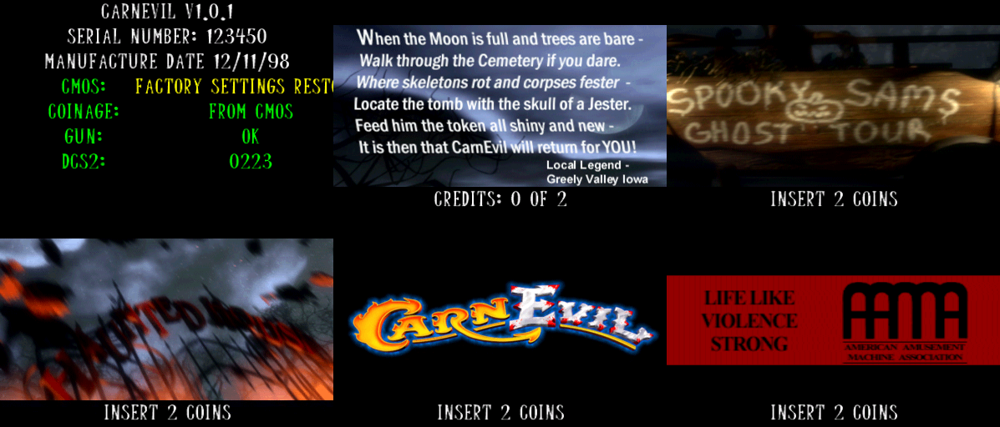

# CarnEvil Static Recompilation

```
     ██████╗ █████╗ ██████╗ ███╗   ██╗███████╗██╗   ██╗██╗██╗
    ██╔════╝██╔══██╗██╔══██╗████╗  ██║██╔════╝██║   ██║██║██║
    ██║     ███████║██████╔╝██╔██╗ ██║█████╗  ██║   ██║██║██║
    ██║     ██╔══██║██╔══██╗██║╚██╗██║██╔══╝  ╚██╗ ██╔╝██║██║
    ╚██████╗██║  ██║██║  ██║██║ ╚████║███████╗ ╚████╔╝ ██║███████╗
     ╚═════╝╚═╝  ╚═╝╚═╝  ╚═╝╚═╝  ╚═══╝╚══════╝  ╚═══╝  ╚═╝╚══════╝

        "Step right up! Don't be shy! Everybody's gonna DIE!"
```

CarnEvil (Midway, 1998) was a light-gun rail shooter on Midway's Seattle board:
a MIPS R5000 with a 3dfx Voodoo 1. This project recompiles the game's MIPS code,
and the board's BIOS, into C with [MidwayRecomp](https://github.com/sp00nznet/MidwayRecomp),
and runs it natively against an emulation of the board's hardware.

The runtime only plays the part of the hardware. It copies the BIOS out of the
boot ROM the way the boot ROM's own warm-reset code does and starts the CPU at
the BIOS entry. From there the BIOS initialises the board, reads the disk image
over emulated IDE, loads `GAME.EXE` and runs it. No game state is set up by hand,
no game function is called out of order, and no memory is poked to get past a
check.

## Status



**Playable, one or two players, locally or over the network.** From power-on
the game boots and runs by itself; coin up and it plays.

| | |
|---|---|
| Boots from the boot ROM: BIOS, PCI, IDE, `GAME.EXE` loaded from disk by DMA | yes |
| CMOS factory restore on a blank board, settings kept between runs | yes |
| Glide on the emulated Voodoo 1; DCS2 sound board booted and streaming | yes |
| Attract mode, complete | yes |
| Coin, start, ride select, gameplay, reload, continue, game over | yes |
| Light gun aim matches the game's factory calibration out of the box | yes |
| Two players on one machine (mouse and a gamepad) | yes |
| **Two players over the network** -- LAN, Tailscale, forwarded port | yes |
| Deterministic: the same inputs give the same run, frame for frame | yes |
| Menu bar: video, sound, controls, cheats, multiplayer | yes |
| Cheats: infinite health, endless ammo, either player; add credits; start at any ride | yes |
| Operator settings: free play, difficulty, starting health, monster strength, violence | yes |

Not checked yet: a physical gamepad and a Sinden gun on real hardware, and
how the audio sounds through speakers (it is produced and played, but nobody
has listened to it here).

## How it works

| Piece | What it is |
|---|---|
| `recomp_out/` (generated) | The game and the BIOS as C, one function per MIPS function. Every load and store goes through the runtime, so device registers behave like a real bus. |
| `src/runtime/hw.c` | The board: GT64010 system controller (PCI configuration, DMA, timers, interrupt cause/mask), PCI IDE disk with bus-master DMA, Midway I/O ASIC with its security PIC, CMOS, light guns, interrupt routing and video timing. |
| `src/runtime/rtos.c` | CPU services: COP0, the BIOS's `break` service calls, address lookup for jumps through pointers, and the BIOS jump table the game copies into itself at startup. |
| `src/runtime/proc.c` | The game's cooperative processes. Midway's dispatcher switches processes by swapping the stack pointer, which C cannot do, so each process runs on a host fiber. The process list, sleep counts, creation and killing are still the game's own code. |
| `src/runtime/voodoo_sst1.c` | The 3dfx Voodoo 1: register file, FIFO and vsync'd swaps, LFB, texture units, pixel pipeline and the DAC behaviour Glide probes. |
| `src/runtime/dcs.c`, `adsp2100.c` | The DCS2 sound board: an ADSP-2115 core booting from the board ROM, the board memory map, host latches, the I/O ASIC FIFO and audio output. |
| `src/runtime/main.c`, `audio.c` | Boot, the window and its menus, mouse, keyboard and gamepad, settings, sound output. |
| `src/runtime/netplay.c` | Two-player lockstep over TCP. |
| `src/runtime/cheats.c` | The Cheats menu: where the game keeps health, ammo, credits and its operator settings, and how each was confirmed. |

Time is driven by the recompiled code itself: every few thousand memory
accesses (and on every COP0 `Count` read) the hardware gets a tick, which
advances the 57 Hz video timing and delivers pending interrupts through the
BIOS's own interrupt dispatcher. That is what lets the game's waits on its
vblank counter, disk flags and timers finish the way they do on the board.
Emulated time never reads the host clock, so a run is a pure function of its
inputs; the wall clock is only used to hold it to the board's 57 Hz.

## Building

You need your own CarnEvil v1.0.1 dumps: the boot ROM `carnevil1_9.u32`, the
DCS2 ROM `sound102.u95`, and the hard disk (MAME's `carnevi1.chd`, decompressed
to a raw image with `tools/chd_extract.py`). Game code and data are not included
in this repository, and the C generated from them is never committed.

```sh
# 1. Recompiler inputs from your boot ROM and disk (checked by SHA-1)
python tools/prepare_inputs.py carnevil1_9.u32 carnevil/carnevi1.img

# 2. Generate recomp_out/ (needs a MidwayRecomp build in ../MidwayRecomp)
tools/regen.sh

# 3. Build (MSVC 2022, CMake 3.20+)
cmake -S . -B build -G "Visual Studio 17 2022" -A x64
cmake --build build --config Release
```

Run from the repository root, with `carnevil1_9.u32`, `sound102.u95` and
`carnevil/carnevi1.img` in place:

```sh
build/Release/carnevil.exe
```

| Input | Does |
|---|---|
| mouse | aim (player 1) |
| left click, or Space | fire |
| right click, or Shift | reload -- the trigger pulled with the gun off the screen, as on the cabinet |
| middle click | the shotgun pump |
| gamepad (XInput) | player 2 by default: left stick aims, A or RT fires, B or LT reloads, X pumps, Start, Back for a coin |
| **5** / **6** | coin 1 / coin 2 (the factory coinage is two coins a credit) |
| **1** / **2** | start 1 / start 2 |
| **9** | service credit |
| **F2** | test switch (the game's operator menu) |
| **F9** | mute |
| **F11**, Alt+Enter | fullscreen |
| Tab (held) | fast forward |
| Escape | leave fullscreen, or quit |

The menu bar has the rest:

| Menu | |
|---|---|
| File | reset, quit |
| Video | window size, fullscreen, sharp or smooth, scanlines, 4:3 or stretch, fast boot (runs flat out to attract mode) |
| Sound | mute, volume |
| Controls | mouse, gamepad as player 1 or 2, cursor hidden / crosshair / pointer, a white border for a **Sinden** light gun |
| Cheats | infinite health and endless ammo for either player, add credits; and the operator settings: **Free play**, **Difficulty**, **Starting health**, **Monster strength**, **Violence** (power-on only, it restarts the game), **Start at ride** (Haunted House, Rickety Town, Freak Show, or straight to the Big Top) |
| Multiplayer | host, join, disconnect, input delay |

Settings live in `carnevil.ini`, the CMOS (high scores, audits, the
operator's settings) in `nvram.bin`. Disk writes stay in memory. The game's
own debug console (the BIOS banner, Glide, the developers' messages) prints
to stderr.

### Two players over the network

One machine hosts and plays player 1; the other joins as player 2. Use the
Multiplayer menu, or the command line:

```sh
build/Release/carnevil.exe --host 7777
build/Release/carnevil.exe --join 192.168.1.20:7777     # or a Tailscale name or address
```

The host's port has to be reachable: on a LAN it is, over Tailscale it is,
and across the internet it needs forwarding (TCP). A session starts at
power-on: the joiner boots with the host's CMOS and settings, and the two
run in lockstep, trading only inputs. That works because the runtime is
deterministic -- emulated time comes from the work the recompiled code does,
not from the host's clock -- so the two machines stay identical; they
compare RAM every two seconds and the title bar says so if they ever stop
being. Input delay (Multiplayer > Input delay) trades latency for
smoothness: 1-2 frames on a LAN, more over distance.

### Testing without a person

```sh
build/Release/carnevil.exe --headless --frames 600 --shot out.ppm
build/Release/carnevil.exe --headless --script play.txt --nvram test_nvram.bin
```

`--headless` runs flat out with default settings. A script is lines of
`frame action [args]`: `coin1`, `start1`, `gun P X Y` (0..255), `fire P`,
`reload P`, `pump P`, `shot FILE.ppm`, `dump FILE`, `quit` (see the top of
`src/runtime/main.c`). `python tools/smoke_test.py build/Release/carnevil.exe`
boots from a blank CMOS and checks the BIOS and game milestones.

Diagnostics: `CARNEVIL_PERF=1` (frame timing), `CARNEVIL_PROFILE=1` (sampling
profiler), `CARNEVIL_TURBO=1`, `CARNEVIL_IDE_TRACE`, `CARNEVIL_IRQ_TRACE`,
`CARNEVIL_PCI_TRACE`.

## Symbol files

`carnevil_syms.toml` and `rtos_syms.toml` tell the recompiler where functions
start. Functions reached only through pointers (driver tables, handlers passed
to the BIOS) and functions whose first instructions were scheduled above the
stack-frame setup were missing from the original lists; `tools/find_entries.py`
and `tools/find_hoisted.py` find them, and `tools/syms_add.py` adds them.
A jump to an address that is still missing stops the runtime with the address.

## License

The code in this repository is MIT (see `LICENSE`), except the files ported
from MAME's BSD-3-Clause sources (the Voodoo, the DCS2 board and its DSP, the
board logic in `hw.c`, the CHD reader), which are BSD-3-Clause and carry the
full notice at the top; `NOTICE` lists them and `python tools/check_notices.py`
checks that each one still has it. The MIT grant covers this project's tools, runtime,
build files and documentation. It does not and cannot cover CarnEvil itself:
the game's code, art, audio and data belong to their rights holders, are not
distributed here, and you need your own legitimate copy. Code the tools
generate from the game is a derivative of it, is made from your own copy, and
is never committed here.

---

*Built with stubbornness, quarters, and the lingering trauma of Tokkentakker by [sp00nznet](https://github.com/sp00nznet)*
